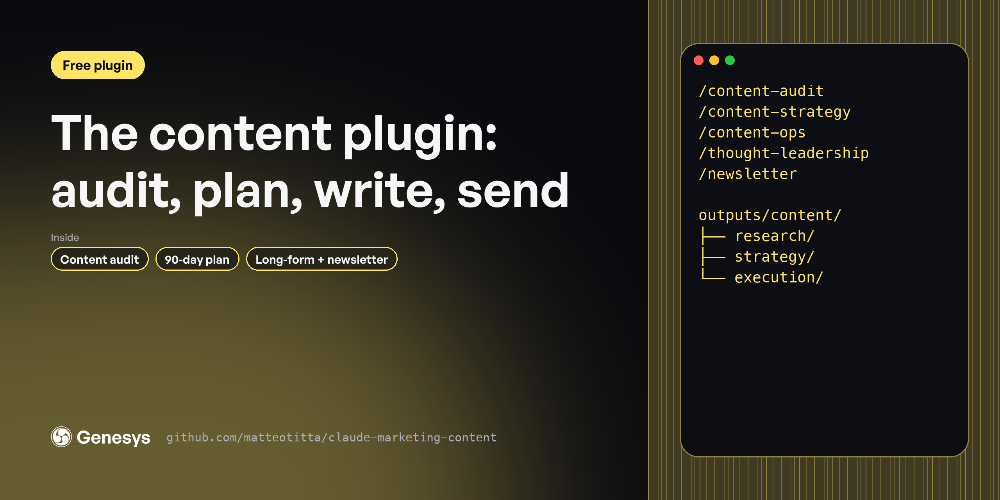

# Content plugin

Content plans stall between the strategy deck and the first draft. These 5 skills audit what you have, plan topics around your buyers' problems, run the calendar and ship long-form pieces and a newsletter. For content leads and founders who write.

**Free, MIT licensed. Works in Claude Code, Claude.ai and Cowork.**

---

## Install

In Claude Code:

```
/plugin marketplace add matteotitta/claude-marketing-content
/plugin install marketing-content@claude-marketing-content
```

From your terminal:

```bash
claude plugin marketplace add matteotitta/claude-marketing-content
claude plugin install marketing-content@claude-marketing-content
```

In Claude.ai or Cowork: download [`claude-marketing-content.zip`](https://github.com/matteotitta/claude-marketing-content/releases/latest) and upload it under *Customize → Plugins → Upload plugin*.

---

## Skills

| Skill | What it does |
|---|---|
| `/content-audit` | Audits a B2B company''s existing content across blog, newsletter, LinkedIn, YouTube and events to set a baseline before planning. |
| `/content-ops` | Turns a content strategy into a system a team can run. |
| `/content-strategy` | Builds a B2B content strategy from your context files. |
| `/newsletter` | Writes one B2B newsletter issue built on a single idea. |
| `/thought-leadership` | Writes long-form thought leadership. |

**Start here:** `/content-audit → /content-strategy → /content-ops → /thought-leadership`

---

## Works best with your context

Every skill reads your context files before it writes: `context/icp/`, `context/positioning/`, `context/messaging/`, `context/brand/` and the rest. If a file is missing, the skill asks you or tells you what it's working without.

The quickest way to set those folders up is a free workspace template:

- [repo-structure-in-house](https://github.com/matteotitta/repo-structure-in-house) for one company
- [repo-structure-agency](https://github.com/matteotitta/repo-structure-agency) for agencies and consultants (swap `context/` for `clients/<client>/context/`)

---

## What the full version adds

These are free, shortened versions of skills from [Marketing Engineering University](https://maven.com/matteo-tittarelli/marketing-engineering-university-genesys-growth). The course versions add the reference material, worked examples and output templates these leave out, plus agents and hooks that chain the skills and check their own work. Week 3 of Marketing Engineering University chains these into a content engine with a review step.

## More free plugins

- [Marketing context plugin](https://github.com/matteotitta/claude-marketing-context)
- [Product launch plugin](https://github.com/matteotitta/claude-marketing-launch)
- [Website plugin](https://github.com/matteotitta/claude-marketing-website)
- [AEO plugin](https://github.com/matteotitta/claude-marketing-aeo)
- [LinkedIn plugin](https://github.com/matteotitta/claude-marketing-linkedin)
- [Build your own GTM skills](https://github.com/matteotitta/gtm-skill-template)

---

Built by [Matteo Tittarelli](https://www.linkedin.com/in/matteotittarelli/) at [Genesys Growth](https://genesysgrowth.com). MIT licensed.
